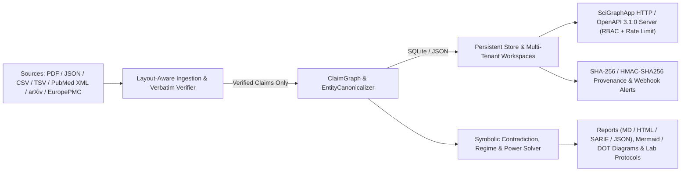

# SciGraph: Neuro-Symbolic Scientific Discovery & Reasoning Engine

[](.github/workflows/ci.yml)
[](LICENSE)
[](pyproject.toml)
[](pyproject.toml)
[](pyproject.toml)

SciGraph ingests multi-column scientific PDFs, structured JSON, CSV/TSV screening tables, and PubMed XML corpora, extracts typed `(Intervention, Condition, Outcome)` claim tuples with verbatim evidence spans, verifies that every DOI, quote, p-value, and sample size exists verbatim in the source text, and resolves cross-paper contradictions into falsifiable experiments through a symbolic constraint solver.

---

## Architecture



- **Domain Models (`src/scigraph/models.py`)**: Strict, frozen Pydantic v2 models (`ConfigDict(strict=True, frozen=True, extra="forbid")`) for `Paper`, `PaperSection`, `LayoutBlock`, `EvidenceSpan`, `ClaimTuple`, `StatisticalEvidence`, `ScientificClaim`, `EvidenceEdge`, `ContradictionPair`, and `FalsifiableExperiment`.
- **Threat Model & ADRs**: See [`docs/THREAT_MODEL.md`](docs/THREAT_MODEL.md), [`AGENTS.md`](AGENTS.md), and [`docs/adr/`](docs/adr/).

---

## Key Capabilities

### 1. Ingestion & Verbatim Verification
- **Multi-format corpus loading (`src/ingest/`)**: Orders two-column PDF layout blocks in reading order (`order_layout_blocks`, `extract_paper_from_pdf_bytes` with `/FlateDecode` stream support), alongside `.json`, `.csv`/`.tsv` (`load_papers_from_csv`), and PubMed EFetch `<PubmedArticleSet>` `.xml` (`parse_pubmed_efetch_xml`).
- **SSRF-guarded literature connectors (`src/ingest/connectors.py`)**: Fetches arXiv Atom XML (`fetch_arxiv_papers`) and EuropePMC JSON (`fetch_europepmc_papers`) over `https://` with non-public IP SSRF guards and a `10 MiB` response cap (`MAX_RESPONSE_BYTES`).
- **Deterministic verbatim verifier**: Rejects any extracted claim whose DOI, verbatim quote slice, p-value string, or sample size `n` does not match the source text verbatim (`verify_claim_verbatim`).

### 2. Claim Graph & Canonicalization
- **Verified graph boundary (`src/graph/claim_graph.py`)**: Stores verified papers and claims, rejects unverified claims at the boundary, and builds `SUPPORTS`, `REPLICATES`, `CONTRADICTS`, and `QUALIFIES` edges across papers sharing normalized `(intervention, outcome)` pairs.
- **Evidence scoring & consensus (`src/graph/scoring.py`)**: Scores claims into `HIGH` / `MODERATE` / `PRELIMINARY` evidence tiers (`score_claim_evidence`) and aggregates directional consensus per `(intervention, outcome)` topic (`compute_topic_consensus`).
- **Non-destructive canonicalization (`src/graph/canonicalizer.py`)**: Normalizes `ClaimTuple` intervention, condition, and outcome aliases via `EntityCanonicalizer` (`DEFAULT_SCIENTIFIC_ALIASES`) while preserving verbatim `EvidenceSpan` offsets and surfacing multi-surface-form clusters (`find_canonical_clusters`).

### 3. Symbolic Contradiction & Regime/Power Solver
- **Unsatisfiable core isolation (`src/solver/symbolic.py`)**: Maps claim effect directions into discrete constraints (`{-1, 0, +1}`) and isolates unsatisfiable cores (`check_claim_set_satisfiability`, `detect_contradictions`).
- **Regime & power calibration (`src/solver/regime.py`)**: Computes quantitative physical/chemical regime deltas (`compute_regime_delta`) and proposes effect-size-calibrated `FalsifiableExperiment` designs (`propose_falsifiable_experiments`).
- **Experiment ROI & lab protocols (`src/solver/prioritizer.py`, `src/solver/protocols.py`)**: Ranks proposals via `prioritize_experiments` (`LOW` / `MEDIUM` / `HIGH` participant cost tiers) and generates 4-phase (`PRE_REGISTRATION`, `RANDOMIZATION`, `MEASUREMENT`, `STATISTICAL_ANALYSIS`) `ExperimentProtocol` sheets (`generate_experiment_protocols`, `render_protocols_markdown`).

### 4. Reporting & Diagrams
- **Multi-format reports (`src/scigraph/exporters.py`, `src/scigraph/explorer.py`)**: Emits Markdown, JSON, OASIS SARIF v2.1.0 CI diagnostics, and an XSS-safe interactive HTML Claim-Graph Explorer with atomic `--output` writes.
- **Graph diagrams & references (`src/scigraph/diagrams.py`, `src/scigraph/diff.py`)**: Exports `ClaimGraph` conflicts to Mermaid (`export_mermaid_flowchart`) or Graphviz DOT (`export_graphviz_dot`), diffs baseline vs. current snapshots (`diff_claim_graphs`), and exports deterministic BibTeX (`export_bibtex`) or RIS (`export_ris`) bibliographies.

### 5. Multi-Tenant Workspaces
- **Isolated tenant stores (`src/scigraph/workspace.py`)**: `WorkspaceManager` isolates `(org_id, workspace_id)` tenants with slug and `is_relative_to` path-traversal guards, per-workspace `graph.db` SQLite stores, and append-only `audit.jsonl` logs.
- **Batch orchestration & webhooks (`src/scigraph/pipeline.py`, `src/scigraph/alerts.py`)**: Declarative `run_pipeline` orchestrator (`PipelineConfig` -> `PipelineSummary`) and SSRF-guarded Slack-compatible webhook notifications (`build_alert_payload`, `dispatch_webhook_alert`).

### 6. Provenance & REST/OpenAPI Server
- **Cryptographic provenance (`src/scigraph/provenance.py`)**: Builds (`build_provenance_manifest`) and verifies (`verify_provenance_manifest`) canonical SHA-256 and optional HMAC-SHA256 manifests over `ClaimGraph` papers, claims, and chained `audit.jsonl` logs.
- **Zero-dependency HTTP/OpenAPI server (`src/scigraph/server.py`, `src/scigraph/security.py`)**: `SciGraphApp` (`ThreadingHTTPServer`) with OpenAPI 3.1.0 schema (`/openapi.json`), constant-time Bearer-token RBAC (`AuthGate`, `load_token_policies`), thread-safe `SlidingWindowRateLimiter`, `2 MiB` body cap, `nosniff`/`no-store` headers, and workspace persistence (`POST /api/v1/verify?persist=true`).

---

## Installation & Configuration

SciGraph requires **Python 3.12+** and **Pydantic v2** (`>=2.9`).

```bash
# Install with uv (recommended)
uv sync --extra dev

# Or install with pip in a virtual environment
python3.12 -m venv .venv
source .venv/bin/activate
pip install -e ".[dev]"
```

### Configuration (`scigraph.toml`)

SciGraph loads optional project configuration from `scigraph.toml` in the working directory (or via `--path`). Both `[scigraph]`-table and top-level keys are supported and validated strictly by `SciGraphConfig`:

```toml
[scigraph]
default_store = "scigraph.db"
workspace_root = ".scigraph/workspaces"
default_org = "research-lab"
server_host = "127.0.0.1"
server_port = 8765
rate_limit = 120
rate_window_seconds = 60.0
```

Inspect the active configuration at any time:

```bash
scigraph config
scigraph config --path scigraph.toml --json
```

---

## CLI Quickstart

Run with `scigraph <subcommand>` (or `PYTHONPATH=src .venv/bin/python -m scigraph.cli <subcommand>`).

```bash
# Version & system diagnostics
scigraph --version
scigraph doctor --json

# Configuration inspection
scigraph config --json

# 30-paper benchmark & verification
scigraph benchmark --json
scigraph verify --input path/to/corpus/

# Reporting (markdown, html, sarif, json)
scigraph report --input path/to/corpus/ --format html --output scigraph-studio.html
scigraph report --input path/to/corpus/ --format sarif --output scigraph.sarif --fail-on-contradictions

# Persistent ingestion, querying & graph diffing
scigraph ingest path/to/corpus/ --store scigraph.db
scigraph query --store scigraph.db --intervention "metformin" --direction increases --json
scigraph diff --baseline baseline.db --current scigraph.db --json

# Consensus scoring, canonicalization, prioritization & lab protocols
scigraph consensus --store scigraph.db --json
scigraph canonicalize --store scigraph.db --json
scigraph prioritize --store scigraph.db --json
scigraph protocols --store scigraph.db --output protocols.md

# Diagrams & reference export
scigraph diagram --store scigraph.db --format mermaid --output graph.mmd
scigraph diagram --store scigraph.db --format graphml --output graph.graphml
scigraph export-refs --store scigraph.db --format bibtex --output refs.bib

# Multi-tenant workspaces
scigraph workspace init --root .workspaces --org acme --workspace cardio --name "Cardio Workspace"
scigraph workspace ingest --root .workspaces --org acme --workspace cardio --input path/to/corpus/
scigraph workspace audit --root .workspaces --org acme --workspace cardio
scigraph workspace export-bundle --root .workspaces --org acme --workspace cardio --output bundle/
scigraph workspace remove-paper --root .workspaces --org acme --workspace cardio --paper-id paper-001 --json

# Literature connectors, provenance, batch pipeline & webhook alerts
scigraph fetch --source arxiv --query "metformin longevity" --output arxiv.json
scigraph provenance build --store scigraph.db --output manifest.json
scigraph provenance verify --store scigraph.db --manifest manifest.json
scigraph pipeline --input path/to/corpus/ --store scigraph.db --report-dir reports/
scigraph alert --store scigraph.db --json

# Local HTTP / OpenAPI 3.1.0 server
scigraph serve --store scigraph.db --host 127.0.0.1 --port 8765
```

### HTTP / OpenAPI Server Endpoints

| Method & Path | Description |
| --- | --- |
| `GET /` | Interactive HTML Claim-Graph Explorer (WCAG 2.1 AA) |
| `GET /health`, `HEAD /health` | Liveness and store status check |
| `GET /metrics` | Server and graph operational metrics |
| `GET /openapi.json` | OpenAPI 3.1.0 specification |
| `GET /api/v1/claims` | Query verified `ScientificClaim` records |
| `GET /api/v1/contradictions` | List detected `ContradictionPair` conflicts |
| `GET /api/v1/consensus` | Compute topic-level directional consensus and claim scores |
| `GET /api/v1/prioritize` | Rank falsifiable experiment proposals by ROI |
| `GET /api/v1/audit` | Read workspace audit events |
| `GET /api/v1/report` | Generate structured contradiction & experiment report |
| `POST /api/v1/verify` | Verify submitted papers/claims (`?persist=true` with workspace binding) |
| `DELETE /api/v1/papers/{paper_id}` | Remove a paper and its claims from the bound workspace |

### Deployment & Security

- **Containerization**: Build and run with [`Dockerfile`](Dockerfile) and configure environment variables using [`.env.example`](.env.example).
- **Security Policy**: See [`SECURITY.md`](SECURITY.md) for vulnerability reporting and hardening guidance.

---

## Reproducible Benchmark Metrics

Measured on Python 3.12 across the 30-paper benchmark corpus (`src/evals/benchmark.py`), including 5 open-access arXiv and PubMed two-column PDF streams (`src/ingest/open_access_corpus.py`) and 150 adversarial decoy claims containing fabricated DOIs, p-values, sample sizes, and quote spans:

| Metric | Target Threshold | Measured Result | Verification |
| --- | --- | --- | --- |
| Structured claim-tuple extraction F1 | >= 0.85 | **1.0000** (60 TP, 0 FP, 0 FN) | `test_30_paper_benchmark_exceeds_acceptance_thresholds` |
| Fabricated DOIs accepted | 0 | **0** (30 / 30 fabricated DOI decoys rejected) | `test_deterministic_verifier_rejects_fabricated_doi_p_value_and_sample_size` |
| Fabricated p-values accepted | 0 | **0** (120 / 120 fabricated p-value, sample-size, and span decoys rejected) | `test_30_paper_benchmark_exceeds_acceptance_thresholds` |
| End-to-end 30-paper pipeline latency (median) | Deterministic local run | **3.415 ms** (range 2.793 to 4.120 ms across 7 runs) | Bound by regex tokenization and Pydantic v2 validation on 1 core |

Regenerate locally and run the full quality gate:

```bash
.venv/bin/ruff check src tests
.venv/bin/mypy --strict src tests
.venv/bin/pytest -v
PYTHONPATH=src .venv/bin/python -m scigraph.cli benchmark
```

---

## Contributing & License

- **Contributing**: See [`CONTRIBUTING.md`](CONTRIBUTING.md) for development setup, coding standards (`ruff`, `mypy --strict`, `pytest`), and PR guidelines.
- **Changelog**: See [`CHANGELOG.md`](CHANGELOG.md) for release history.
- **Architecture Decision Records**: See [`docs/adr/`](docs/adr/) for design rationale (`001` through `007`).
- **License**: Released under the [MIT License](LICENSE).
